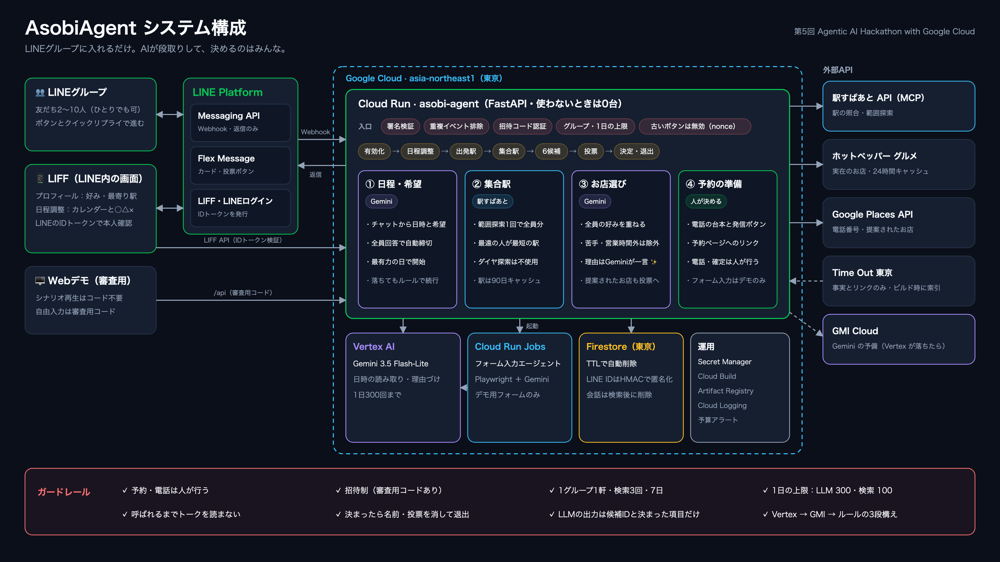

# AsobiAgent（アソビ・エージェント）

LINEグループに入れるだけで、**日程 → 公平な集合駅 → みんなの好みに合うお店 → 予約の準備**までを段取りする
エージェントです。AIが段取りをして、決めるのは人。第5回 Agentic AI Hackathon with Google Cloud の提出作品です。



[](LICENSE)
English summary: [below](#english-summary).

## LINEグループでの流れ

| | 何が起きるか | AI・API |
|---|---|---|
| ① 有効化 | ボットを招待しても、**招待コードで認証した人**が 有効化する を押すまで何も読まない。 | — |
| ② 日程調整 | 📅 日程を決める → 幹事がカレンダーで候補日を選び、全員が ○△× を付ける（LIFF）。**全員が答えたら自動で締め切る。** | — |
| ③ プロフィール | 好き・苦手・最寄り駅を、カードをタップして一度だけ登録（LIFF）。位置情報から最寄り駅も探せる。 | 駅すぱあと（駅の照合） |
| ④ 集合駅と候補 | 🍽 プランを立てる → 日程調整の最有力の日で、**一番遠い人の移動が最短になる駅**を選び、全員の「好き」を重ねた6軒を出す。苦手な料理と、予定時刻に閉まっている店は出さない。理由はGeminiが一言で書く（✨）。 | 駅すぱあと 範囲探索×1、ホットペッパー、**Gemini（Vertex AI）×1〜2** |
| ⑤ 投票 | いいと思う店に**いくつでも**投票（承認投票）。全員一致ならその場で決定。メンバーがお店を提案して候補に加えることもできる。 | Places（提案時のみ） |
| ⑥ 予約の準備 | 決まったら、日付・人数入りの**電話の台本とワンタップ発信**、ホットペッパーの予約ページ。名前と投票を消して、ボットはグループを退出する。 | Places（電話番号） |

入力欄の上には、その時点で押せるボタンだけが出ます（クイックリプライ）。ボットは**電話も予約確定もしません**。
「AIに入力を任せる」のフォーム入力エージェント（Cloud Run Jobs ＋ Playwright ＋ Gemini）は、デモ用のフォームにだけ入力します。

## 試し方

- **LINE版：** 友だち追加 `@939yxude`（AsobiAgent M1）→ 1:1トークで招待コード（審査用コードは提出フォームの「動作確認の方法」に記載）を送る →
  プロフィールを登録 → グループを作ってボットを招待（**ひとりグループでも最後まで試せます**）。
- **Webデモ：** <https://asobi-agent-558141828292.asia-northeast1.run.app/> 。シナリオ再生はコードなし、
  自由入力は「審査用コード」を入れると Gemini で動きます。各エージェントのログと駅すぱあとの結果が右側に出ます。
- **スライド：** `/presentation_ja.html`（`N` キーで台本の表示・非表示、`F` で全画面）。

## 自律性と、それを抑える仕組み

**エージェントが自分で判断すること：** 全員が日程に答えたら締め切る／最有力の日でプランを始める／全員の駅がそろったら
検索する／好みと営業時間から候補を選び、理由を書く／状態に合わせて次に押すボタンを出し分ける。

**人が決めること・使いすぎない仕組み：**

- 予約と電話は人が行う。AIは台本と発信ボタンを用意するだけ。
- 招待制。1グループ1軒・検索3回・7日・10人まで。1人2グループまで。
- 1日の上限（LLM 300・検索 100・Places 30・Webデモ 120）と予算アラート。
- Webhookは署名検証、重複イベントは無視、古いボタン（nonce）は無効。
- **LLMは候補IDから選び、決まった項目を埋めるだけ。** 出力は実在のデータと照合してから使うので、プロンプトを注入されても
  存在しない店や操作は作れない。URLや長すぎる文は捨てる。
- **Vertex AI → GMI Cloud → ルール** の3段構え。LLMが止まってもグループは止まらない。
- ログに会話の中身は残さない（イベントの種類、どのモデルが何秒で答えたか、エラーだけ）。管理者は `/stats` で利用量を確認。

## プライバシー

- 呼ばれるまでトークは読まずに捨てる。募集中も、参加した人のメッセージだけを読む。
- LINEのユーザーIDとグループIDはHMACで変換してから保存。
- 会話は検索後、名前と投票は決定時に削除。プラン7日・日程調整14日・プロフィール180日でFirestoreのTTLが自動削除。プロフィールはいつでも自分で削除できる。
- Geminiには名前を渡さない（「焼肉が好きな人：2人」のような人数と、「参加者1」のような番号だけ）。
- 公開ページ：`/privacy`

## 使っている技術

| | |
|---|---|
| 実行 | **Cloud Run**（ボット・LIFF・Webデモ、使わないときは0台）、**Cloud Run Jobs**（フォーム入力エージェント） |
| AI | **Gemini 3.5 Flash-Lite on Vertex AI**（OpenAI互換エンドポイント、サービスアカウント認証）。予備に GMI Cloud |
| データ | **Firestore**（東京、TTL）、**Secret Manager**、Cloud Build、Artifact Registry、Cloud Logging、予算アラート |
| 外部API | 駅すぱあと API MCPサーバー（ダイヤ探索は不使用）、ホットペッパー グルメ、Google Places API (New)、Time Out（事実とリンクのみ） |
| LINE | Messaging API（返信のみ、プッシュ0通）、Flex Message、クイックリプライ、LIFF、LINEログイン（IDトークン検証） |

## コード構成

| パス | 内容 |
|---|---|
| `server.py` | FastAPI：`/webhook`（署名検証）、LIFF API、Webデモ API、フォーム入力ページ、`/privacy` |
| `bot/group.py` | グループの状態遷移（有効化 → 日程調整 → 募集 → 検索 → 投票 → 決定） |
| `bot/poll.py` | 日程調整（候補日、○△×、集計） |
| `bot/onboarding.py` | 1:1トーク：招待コード、審査用コード、管理者コマンド |
| `agents/schedule_agent.py` | Agent 1：日時と希望の読み取り（Gemini、ルールで補完） |
| `agents/ekispert_agent.py` | Agent 2：集合駅（駅すぱあと 範囲探索） |
| `agents/group_picks.py`, `agents/spot_agent.py` | Agent 3：好みを重ねた候補、営業時間の判定、Geminiの推薦理由 |
| `agents/voice_agent.py`, `agents/form_agent.py` | Agent 4：電話の台本、フォーム入力エージェント |
| `services/` | LINE・駅すぱあと・ホットペッパー・Places・LLM（Vertex → GMI）のクライアント、Firestore、上限カウンター、好みの計算 |
| `web/liff.py`, `static/liff/` | LIFF：プロフィール、最寄り駅、カレンダー、○△× |
| `jobs/form_agent/` | Cloud Run Job（Playwright） |
| `deploy/` | `deploy.sh`（setup / secrets / app / agent / webhook） |
| `docs/` | [デプロイ手順](docs/DEPLOYMENT.md)、[Time Outの扱い](docs/TIMEOUT.md)、[構成図](docs/architecture/) |
| `tests/` | 自動テスト 76件（グループの一連の流れ、上限、削除、フォールバック、審査用コード、ひとりグループ） |

## ローカルで動かす

```bash
python3 -m venv .venv && .venv/bin/python -m pip install -r requirements-dev.txt
cp .env.example .env     # 手元にあるキーだけ入れる
./run.sh                 # http://localhost:8000
.venv/bin/python -m pytest -q
```

ローカルではメモリ上のストアを使い、LINEのアクセストークンがなければ返信は送らずに記録だけします。

## データソースの規約

- **駅すぱあと MCP：** 時刻表を使わない機能だけ（`get_stations`、`get_stations_from_geo`、平均待ち時間込みの `search_ranges`）。
- **ホットペッパーグルメ Webサービス：** データを使うカードに「Powered by ホットペッパーグルメ Webサービス」を表示し、キャッシュは24時間以内。
- **Time Out：** 規約で複製・転載・翻訳が禁止されているため、店の事実（名前・座標・住所・電話・営業時間）とURLだけを保存し、
  本文や写真は表示しない。詳細：[docs/TIMEOUT.md](docs/TIMEOUT.md)
- **Google Places：** 電話番号はキャッシュせず、1日の上限つき。

## デプロイ

[docs/DEPLOYMENT.md](docs/DEPLOYMENT.md)。要約：`PROJECT_ID=asobi-agent-xxxx ./deploy/deploy.sh all`

## English summary

AsobiAgent is a LINE bot that plans an outing inside a group chat: a calendar date poll that closes itself when
everyone has answered, one-time taste profiles, a fair meeting station from a single Ekispert range search, six
places that cover everyone's tastes (with a one-line reason written by **Gemini on Vertex AI**), approval voting,
and a dated call script with tap-to-call. People make the call and the booking; the bot never does.

Guardrails: invite-only activation, per-group and daily caps, signed webhooks, stale-button checks, LLM output
limited to known candidate ids and fixed fields, and a Vertex AI → GMI Cloud → rules fallback chain. LINE IDs are
HMAC-hashed, chat is deleted after the search, names and votes at the decision, and Firestore TTLs remove the rest.
It runs on Cloud Run, Cloud Run Jobs, Firestore and Secret Manager. Slides: `/presentation_en.html`.
