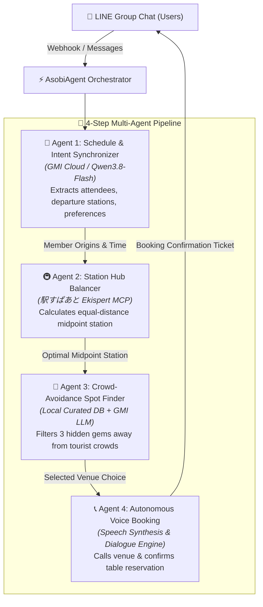
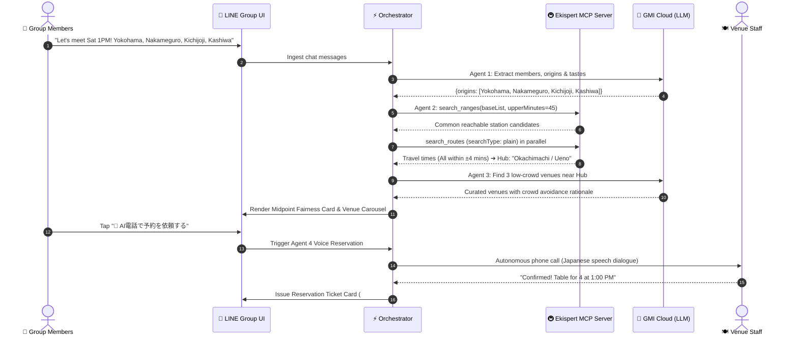

# 🤖 AsobiAgent (アソビ・エージェント)

> **Autonomous Multi-Agent Concierge for Group Outings in High-Density Urban Cities**  
> *Developed for the 5th Agentic AI Hackathon with Google Cloud (第5回 Agentic AI Hackathon with Google Cloud)*

[](https://opensource.org/licenses/MIT)
[](https://www.python.org/)
[](https://fastapi.tiangolo.com/)
[](https://cloud.google.com/run)
[](https://docs.ekispert.com/)
[](https://gmicloud.ai/)

---

## 📖 Overview

Planning weekend outings with 4–6 friends in Tokyo is notorious for **"Kanji Fatigue" (幹事疲れ)** and severe weekend overcrowding. A single lunch plan often requires over 30 scattered LINE messages, creates unspoken friction over unbalanced travel times, and ends in a 45-minute wait outside a packed Shibuya cafe.

**AsobiAgent** solves this natively inside **LINE group chats**. Just invite the bot to your group: it passively synchronizes member availability, uses the **駅すぱあと (Ekispert) API MCP Server** to calculate the most equal midpoint station, curates low-crowd hidden gems (穴場), and autonomously calls traditional Japanese venues to reserve tables over the phone.

---

## ⚡ Key Highlights

* **Zero App Downloads / Native LINE UX:** Runs directly inside LINE using rich **LINE Flex Messages** (poll cards, fairness charts, venue carousels, reservation tickets).
* **Ekispert Non-Timetable Compliance (`ダイヤ情報不使用`):** Strictly follows hackathon guidelines by using topological range search (`multipleRange`) and average travel durations (`searchType: plain`) to achieve travel equality ($\le \pm 5$ mins) without relying on specific timetables.
* **Crowd Avoidance Intelligence:** Identifies calm back-alley venues, spacious bistros, and reservation-only spots away from tourist choke points.
* **Autonomous Voice Reservation Agent:** Capable of generating dynamic Japanese telephone booking dialogues and autonomously calling non-tech venues.
* **Dual-Language Pitch Deck Included:** Interactive HTML presentation slides in Japanese (`presentation_ja.html`) and English (`presentation_en.html`) with phonetic speaker notes.

---

## 🏗️ Architecture & Multi-Agent Pipeline

AsobiAgent coordinates 4 specialized autonomous agents sequentially:



---

### Multi-Agent Interaction Sequence



---

## 🛠️ Tech Stack

| Component | Technology | Description |
|---|---|---|
| **Backend** | Python 3.11+, FastAPI, Uvicorn | High-performance asynchronous API server |
| **Transit Intelligence** | **駅すぱあと (Ekispert) API MCP Server** | Official MCP endpoint (`https://api-mcp.ekispert.jp/mcp`) |
| **LLM Inference** | **GMI Cloud (`Qwen/Qwen3.8-Flash`)** | High-speed 1M context open-source model inference |
| **Cloud Hosting** | **Google Cloud (Cloud Run)** | Serverless containerized deployment with auto-scaling |
| **Messaging UI** | **LINE Messaging API (Flex Messages)** | Authentic cards, carousels, action postbacks |
| **Frontend / Simulator**| Vanilla JS, CSS3, Web Speech API | Dual-view LINE chat mockup + telemetry inspector |

---

## 🚀 Quickstart & Local Setup

### 1. Clone Repository & Setup Environment

```bash
git clone https://github.com/<your-username>/asobi-agent.git
cd asobi-agent

# Create virtual environment
python3 -m venv .venv
source .venv/bin/activate

# Install dependencies
pip install -r requirements.txt
```

### 2. Configure Environment Variables

Copy `.env.example` to `.env`:

```bash
cp .env.example .env
```

Edit `.env` with your API keys:

```env
# GMI Cloud Credentials (or OpenAI-compatible endpoint)
GMI_API_KEY=your_gmi_api_key_here
GMI_BASE_URL=https://api.gmi-serving.com/v1
GMI_MODEL=Qwen/Qwen3.8-Flash

# 駅すぱあと (Ekispert) API MCP Server Credentials
EKISPERT_API_ACCESS_KEY=your_ekispert_access_key_here
EKISPERT_MCP_URL=https://api-mcp.ekispert.jp/mcp
```

### 3. Run the Application

```bash
./run.sh
```
*(or manually with `.venv/bin/python server.py`)*

Open **`http://localhost:8000`** in your browser:
* **Interactive Live Demo:** `http://localhost:8000`
* **Japanese Slide Deck:** `http://localhost:8000/presentation_ja.html`
* **English Pitch Deck & Notes:** `http://localhost:8000/presentation_en.html`

---

## ☁️ Google Cloud Deployment (Cloud Run)

AsobiAgent is fully containerized and ready for **Google Cloud Run**.

### Step 1: Authenticate Google Cloud CLI
```bash
gcloud auth login
gcloud config set project <YOUR_GCP_PROJECT_ID>
```

### Step 2: Build & Deploy to Cloud Run
Deploy directly from source using Google Cloud Build:

```bash
gcloud run deploy asobi-agent \
  --source . \
  --region asia-northeast1 \
  --platform managed \
  --allow-unauthenticated \
  --set-env-vars GMI_API_KEY="YOUR_GMI_KEY" \
  --set-env-vars EKISPERT_API_ACCESS_KEY="YOUR_EKISPERT_KEY"
```

Once deployed, Cloud Run will output your live HTTPS URL:
```text
Service URL: https://asobi-agent-xxxxxx-an.a.run.app
```

You can point your **LINE Messaging API Webhook URL** directly to `https://asobi-agent-xxxxxx-an.a.run.app/webhook`.

---

## 🛡️ Hackathon Rule Compliance Note

> **ダイヤ情報の利用制限への対応策 (Non-Timetable Compliance Statement):**  
> 本リポジトリのコードは「駅すぱあと」APIの時刻指定ダイヤ探索機能を使用していません。`ekispert_api_search_ranges` による到達可能駅探索および `searchType: "plain"`（平均乗車時間探索）による相対的な移動コスト比較のみに限定して使用しており、時間調整・スケジューリングはLLMオーケストレーター側で自律処理しています。

---

## 📑 Presentation Slides

The project includes standalone slide decks for pitching:
* **[`presentation_ja.html`](presentation_ja.html):** Japanese slides formatted for projection to judges.
* **[`presentation_en.html`](presentation_en.html):** English slides with Romanized Japanese pronunciation cheatsheets.

To present, open either HTML file in any browser and navigate using the arrow keys `[←]` / `[→]`.

---

## 📄 License

This project is licensed under the **MIT License** — see the [LICENSE](LICENSE) file for details.
