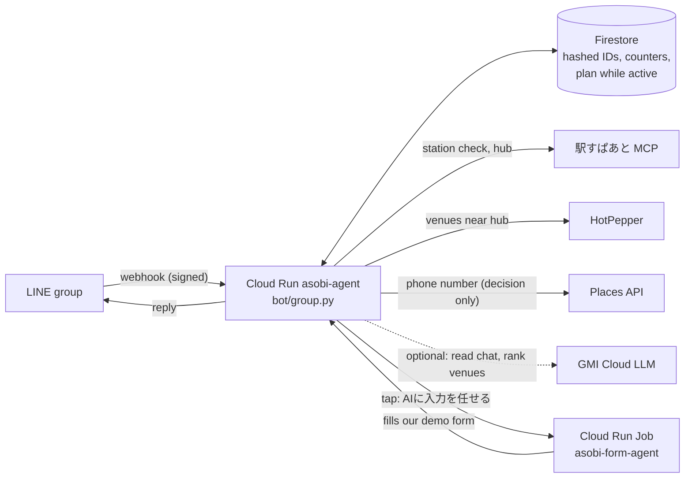

# AsobiAgent: deployment guide

> **Status (2026-10-09): ready to deploy, not deployed.** The code, tests and `deploy/deploy.sh` are done.
> Creating the Google Cloud project needs your go-ahead, because it attaches to your billing account.

## 0. What will run

| Piece | Name | Cost while idle | Notes |
|---|---|---|---|
| Bot + web pages | Cloud Run service `asobi-agent` | ¥0 (scales to zero) | Public: LINE must reach `/webhook`. Every request is checked against LINE's signature. |
| Form agent (demo) | Cloud Run Job `asobi-form-agent` | ¥0 | Runs ~30 s when someone taps 「AIに入力を任せる」. Chromium inside. |
| Database | Firestore (Tokyo) | ¥0 at this size | Free tier: 50k reads / 20k writes per day. Auto-delete (TTL) on `expire_at`. |
| Keys | Secret Manager | ~¥0 | ~9 secrets. |
| Images | Artifact Registry `asobi` | ~¥30/month | The Playwright image is ~2 GB; a cleanup policy keeps the 3 newest. |
| Phone numbers | Places API (New) | ¥0 inside the free monthly usage | Capped in code: `DAILY_PLACES_LIMIT` (30/day). |
| Budgets | "AsobiAgent credit burn" ¥1,000 (before credits), "AsobiAgent real money" ¥100 (after credits) | — | Email alerts only, same pattern as kechi-plus. |

It gets its **own project** (`asobi-agent-xxxx`) on the same billing account as kechi-plus, so its costs and
budgets are separate, and nothing lands in the hackathon project by accident.

## 1. How a LINE message flows



The bot answers inside the webhook request (Cloud Run only guarantees CPU while a request is open) and only
ever **replies**, so LINE's 200 free messages a month go unused.

## 2. LINE settings (once)

| Where | Setting |
|---|---|
| Official Account Manager → 設定 → 応答設定 | チャット **OFF**, あいさつメッセージ **OFF**, 応答メッセージ **OFF**, Webhook **ON** (possible once a webhook URL is set) |
| Official Account Manager → 設定 → アカウント設定 | グループ・複数人トークへの参加を許可する **ON**. Optional: rename the account to AsobiAgent. |
| Developers Console → channel → Messaging API | Channel access token (long-lived) → **Issue** → into `.env` as `LINE_CHANNEL_ACCESS_TOKEN` |
| Developers Console → channel → Basic settings | Privacy policy URL → `https://<service-url>/privacy` |
| Webhook URL | Set by `deploy.sh webhook` through LINE's API, which also runs LINE's connection test |

## 3. Deploy

Everything is in `deploy/deploy.sh`. Each command names the project explicitly, because this Mac's gcloud default is
the hackathon project.

```bash
export PROJECT_ID=asobi-agent-$(LC_ALL=C tr -dc 'a-z0-9' </dev/urandom | head -c 4)   # pick once, keep it
./deploy/deploy.sh setup     # project, billing link, budgets, APIs, Firestore + TTL, image storage,
                             # service accounts, Places key, secrets from .env
./deploy/deploy.sh app       # build and deploy the bot (prints the URL)
./deploy/deploy.sh agent     # build and deploy the form agent job (a few minutes: Chromium)
./deploy/deploy.sh webhook   # tell LINE where the bot is, and test it
```

`setup` copies these `.env` values into Secret Manager without printing them. Empty ones are skipped.

| Secret | From `.env` | Notes |
|---|---|---|
| `line-channel-secret` | `LINE_CHANNEL_SECRET` | Verifies that webhooks really come from LINE |
| `line-channel-access-token` | `LINE_CHANNEL_ACCESS_TOKEN` | Lets the bot reply and leave groups |
| `line-admin-user-id` | `LINE_ADMIN_USER_ID` | You: can issue invite codes, always verified |
| `ekispert-api-key` | `EKISPERT_API_ACCESS_KEY` | |
| `hotpepper-api-key` | `HOTPEPPER_API_KEY` | |
| `gmi-api-key` | `GMI_API_KEY` | Optional. Without credit the bot falls back to rules. |
| `places-api-key` | created by `setup` | Restricted to Places API (New) |
| `app-secret` | generated | Hashes LINE IDs and signs links. **Changing it orphans every stored record.** |
| `admin-api-token` | generated | Unlocks free-text chat on the web simulator: open `/?admin=<token>` once |

To read the admin token: `gcloud secrets versions access latest --secret=admin-api-token --project=$PROJECT_ID`.

## 4. After deploying: first run

1. Add the bot as a friend (QR code in Official Account Manager, or `https://line.me/R/ti/p/@939yxude`).
2. DM it `/invite 5`. It replies with five single-use codes (valid 14 days). `/stats` and `/limits` also work.
3. Give a code to a friend. They add the bot and send the code.
4. Make a group, invite the bot, tap 有効化する, then `@AsobiAgent 土曜13時からランチ` (or tap プランを立てる).

## 5. Limits (environment variables on the service)

| Variable | Default | Meaning |
|---|---|---|
| `PLANS_PER_GROUP` | 1 | Decided venues per group, then the bot leaves |
| `SEARCHES_PER_GROUP` | 3 | First search + refinements (もっと安く, 個室, 駅近, free text) |
| `GROUP_ACTIVE_DAYS` | 7 | Days after activation before the bot leaves |
| `ACTIVATION_WINDOW_HOURS` | 24 | A group nobody activates is left after this |
| `MAX_PARTICIPANTS` | 10 | Per plan |
| `GROUPS_PER_USER` | 2 | Groups each verified person can activate (admin: unlimited) |
| `DAILY_SEARCH_LIMIT` / `DAILY_LLM_LIMIT` / `DAILY_PLACES_LIMIT` | 100 / 300 / 30 | Whole service, per day (Japan time) |
| `DAILY_SIMULATOR_LIMIT` / `DAILY_AGENT_LIMIT` | 120 / 20 | Web demo calls (scenario runs and venue picks) and form agent runs per day |
| `INVITE_TTL_DAYS` | 14 | |

Change one with `gcloud run services update asobi-agent --update-env-vars=SEARCHES_PER_GROUP=5 --region=asia-northeast1 --project=$PROJECT_ID`.

## 6. Day to day

- **Redeploy after code changes:** `./deploy/deploy.sh app`
- **Logs:** `gcloud run services logs read asobi-agent --region=asia-northeast1 --project=$PROJECT_ID --limit=100`
- **Rotate a key:** change it in `.env`, then `./deploy/deploy.sh secrets && ./deploy/deploy.sh app`
- **Refresh the Time Out index:** `.venv/bin/python -m jobs.timeout_crawl --since 2024-01-01` (about an hour,
  polite rate), then `./deploy/deploy.sh app` (the index ships inside the image).
- **Tear down everything:** `gcloud projects delete $PROJECT_ID`. Budgets live on the billing account: delete them
  under Billing → Budgets & alerts.

## 7. Privacy and data, as implemented

- LINE user and group IDs are stored only as HMAC hashes (`services/ids.py`).
- Nothing is read while a group is idle. During 募集 only participants' messages are held (max 50), and they're
  deleted when the search runs. Stations are deleted once the hub is known; names and votes at the decision.
- Abandoned plans expire after 7 days (Firestore TTL deletes them within about a day after that; the app treats them
  as gone immediately). Group counters expire 90 days after last use.
- The public page `/privacy` says the same in Japanese.

## 8. Gotchas

- **Webhook switch greyed out** in 応答設定 until a webhook URL is set.
- **チャット ON in 応答設定** makes LINE treat the account as a manual inbox. Keep it off.
- **LINE PC doesn't send user IDs to bots in groups**, so buttons only work from the phone app (the bot says so).
- **Cold start:** the first message after a quiet period takes a few extra seconds. `--min-instances=1` would fix
  that but bills all the time.
- **GMI credit:** a 402 "Insufficient balance" from GMI means the LLM steps silently use the rule-based fallback.
  Check the GMI console balance (the key is shared with kechi-plus).
